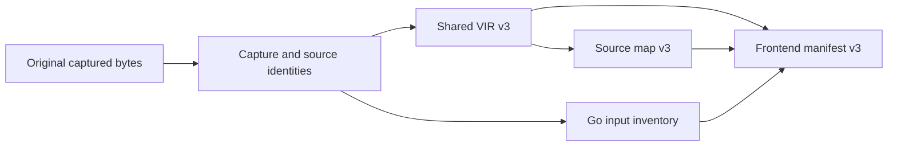

# Common source maps, frontend manifests and Go input inventories

This W04 draft closes three roots: common source-map v3, common frontend-
manifest v3 and Go input-inventory v1. The [catalogue](schema.json) owns exact
required fields, tagged payloads, canonical preimages, limits and planned
production owners. Eight [artifact triples](artifacts.json) bind the preceding
shared VIR to maps and frontend manifests across all five profiles, both Rust
targets and an independently authorized synthetic Go origin. Practical-Go
source/ordinary proofs and complete shared-family publication remain due.

| Root | Domain | Required fields |
| --- | --- | --- |
| `mpk.source_map.v3` | `MPK-SOURCE-MAP-3.0` | 7 |
| `mpk.source_manifest.frontend.v3` | `MPK-SOURCE-MANIFEST-FRONTEND-3.0` | 7 |
| `mpk.go.input_inventory.v1` | `MPK-GO-INPUT-INVENTORY-1.0` | 5 |

Each root hashes every required field except its own digest, including its
schema, full context and complete payload. Map and frontend-manifest roots
bind exact compiled profile-contract v2 identities. Their profile arm follows
the validated full common VIR/context. The map binds common VIR v3 and its
hash; the manifest binds that exact VIR and map hash. Old/future/certificate
roots, extra caller/proof fields, stale references and crossed contexts reject.
The new Go inventory identity avoids all earlier Go and reserved inactive C#
names. Earlier private helpers and frozen production schemas stay unchanged.

The [new consumer](../../../../probes/go-practical/capture_artifacts.py)
validates the preceding typed module and reconstructs Go authority from its
original immutable project specification. It caches successful module checks
by the complete canonical VIR bytes. A reused digest or changed nested body
cannot borrow an earlier validation. Constructor input/authority buffers are
copied; caller mutation supplies no later authority.

Go maps contain exactly one entry per function, every one of the seven body
node arms and every region terminator, including scope children and resume
continuations. References use declaration IDs and canonical function-local
node/region IDs. Order is function, instruction, terminator, with numeric
node/region order inside each declaration. The function uses its captured
declaration span, nodes use their body anchors, and terminators inherit their
enclosing anchor. Every range is nonempty and lies on UTF8 boundaries in the
exact captured Go source object. These are locators; AST/lowering/execution
correspondence remains a separate proof obligation. Broad inherited spans are
kept explicitly. Go v1 uses captured spans throughout.

The function/node/terminator counting retains the predecessor map cap of
323,728 entries and 32MiB canonical bytes. Regions are represented by their
terminator entries, preserving the function+instruction+block accounting.
Frontend manifests retain 4MiB canonical bytes, 32,768 inputs and 256 units;
both roots retain 256MiB transport, depth256 and 1MiB decoded strings. These
per-artifact limits complement the preceding 64-counter candidate package.
Complete production ingress/runtime accounting remains required.

The Go inventory contains every real source object in capture-ID order using
the existing exact source-object v1 shape. Original raw buffers must match
each size and SHA. Paths are unique under ASCII case folding within each
capture capability; capabilities keep distinct module roots separate.
Source/overlay counts, per-file and total bytes are checked against the existing
candidate bounds. No derived default contract fabricates a raw sidecar.
Two real overlays yield four captured objects; default-only contracts yield
the original Go and go.mod objects. The manifest additionally binds full
capture, build configuration, module/package records, exact selection and
the registered limit reference already carried by its semantic context.

The capture model still covers the preceding single Go fixture package.
General original-project/module capture, all source-kind buffers, independent
AST import and source/call/control/lifetime/activation proofs remain T02–T06
work. The modeled Quote/Error bodies retain their preceding typed-candidate
scope. InputErrors still needs its discard-erasure correspondence proof.
Source-object and map linkage do not establish a Go application claim.

Retained arms keep their original reference/origin and manifest payload
structures. The [native observer](../../../../probes/go-practical/capture-native/src/main.rs)
calls the actual unchanged public successor VIR, source-map and frontend-
manifest validators. All 226 Rust source files in the linked production crates
are pinned; this observer appends no facade to production or a mirror. Its
[build](../../../../probes/go-practical/capture_native_build.py) preserves original
registry dependency versions/checksums and uses the recorded nonincremental,
no-debug, single-codegen-unit configuration.

Synthetic permissions come only from independent captured authority, with
the same exact reference/reason matching as the retained validator. A map
cannot grant its own permission. The extra Go case succeeds with one exact
permission and rejects a changed reason. Java retains its stricter source-only
map and empty-permission rules. UTF8 split ranges reject in C# and Java.
Input size/SHA/inventory, selection and target corruptions reach the real
retained manifest importer, including recomputed input-set hashes.

Five [baselines](baseline-queries.json) preserve complete validated old map and
manifest values in Go fixed, Rust32/64, C# and Java. Go/Rust64 use original
fixture roots unchanged; the other contexts use independently formed old-family
fixture payloads. The original empty go.sum and generated Rust Cargo metadata
are exact literal bytes already used by the retained tests, checked against
their original manifest sizes/SHAs. C#/Java boolean fixtures have explicit UTF8
source and closed contract bytes. These checks are fixture preservation,
with no universal source/preservation theorem inferred.

External release references use the distinct successor family and are checked
against independent immutable authority before any old-family observation
projection. The [private reference fixture](schema.json) is incomplete and
uninstalled. Go tool/frontend identity payloads are historical fixed-profile
samples used for structure and linkage. Registered practical-Go producer,
toolchain, bundle-registry and execution/provenance evidence remain release
obligations. The receipt keeps registered-provenance acceptance false.

The [187 cases](vectors.json) retain eight linked-unproved maps, eight linked-
unproved frontend manifests and 171 configuration rejections. The
[24 selected tests](../../../../probes/go-practical/test_capture_artifacts.py)
add nested if/scope/resume coverage, immutable/hot-cache authority, exact real
inputs/defaults, rehashed inventories/captures and map/manifest/capture limits.
All 19 complete preimages agree across Python, Rust and Go: eight maps, eight
frontend manifests, two inventories and one private external-reference fixture.
Each native observer runs twice identically. The [receipt](observations.json)
pins 652 inputs and the same 14,496-file Go1.25.0 inventory.

The [verification record](verification/verification.json) retains selected raw
logs, reasons and the initial private observer setup failure. The missing hash
placeholder was fixed before classification; its raw inputs/outputs remain
under verification. W04 stays In progress. Certificate-manifest/VC, frontend
envelope, policy/API/release roots and reviewed migrations remain due. W05 owns
inactive publication and the cumulative T01 gate; all T02–T11 work remains
active and no practical Go profile is activated.
