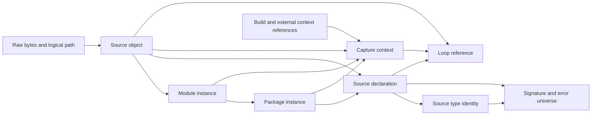

# Candidate family and acyclic source identity protocol

Status: W04 private identity/hash draft; full schemas and migration remain open.
Entry: `47b2a5e9846b5200ca1106ab9407de310af6e169`.
The [catalog](catalog.json) proposes101 distinct identities and41 hash domains.
None reuses the frozen inactive C# package's102 successor identities/42
domains. This does not publish a schema, activate a route, change Certificate
v0 or implement a production source importer.

## 1. Separate the Go-owned family from reserved C# meanings

Current shared artifacts use registry/context v1, VIR v1 and VC/API v2.
The [inactive C# contract](../../../../specs/CSHARP_PRACTICAL_SHARED_ARTIFACTS_V1.md)
reserves registry/context/VIR v2, VC/policy/API v3 and its C# foundation.
Go's candidate uses registry/context/VIR/frontend/map/manifest/release v3,
VC/policy/API/AI v4, and Go practical source/foundation identities v1. Compiled
profile-contract names use v2 because their v1 names are also C#-reserved.

The future v1 cutover contains the four existing semantic profiles and
mpk.go.practical.v1 in one installed family. It does not activate practical
C#. The C# frozen preimages and private parser/proof sources remain retained;
later C# work must reconcile intervening Go releases. Generic input-set and
bundle-inventory domains can be retained only where their exact fields,
preimages and meaning remain unchanged; their full review is still required.

Most shared/Go rows are candidate names, not complete root shapes. Exactly ten
source-identity record schemas and the five-arm source-type identity union are
closed in this checkpoint: source object, module, package, declaration, type,
signature, closed error universe, build configuration, capture context and
loop reference. Binding/call-site IDs, full type definitions, foundation/
context/request/contract/source-map/VIR/VC/API root and operation/expression
unions still require their complete freeze. Nothing silently fills them with
an empty or opaque accepted public payload.

## 2. Identity order and complete typed preimages

Every identity uses lowercase SHA-256 of ASCII domain, one zero byte and
narrowed RFC8785 canonical JSON without LF. The required schema and every
active payload field enter the preimage; only the record's id is excluded.
Source-type arms explicitly enumerate their own complete preimage fields.
Unknown/extra/missing members, later schemas and inactive arm payloads reject.

Raw overlay bytes are source objects before capture. No normalized-contract
digest belongs in the capture record; attempting to add one rejects. Derived
contracts and loop bindings follow capture. A nominal type identity uses its
type declaration locator, not its own complete method set; method declarations
then reference that receiver type without a hash cycle. Complete underlying
type definitions and source/semantic correctness must be checked separately.

Aliases resolve to the target type identity and keep a separate source alias
declaration. Distinct defined types remain distinct even when both represent
int64. Builtin int and int64 retain separate source identities at width64;
full words are not narrowed to JSON's safe integer range. Word values use
typed decimal strings where required. Anonymous struct field order/type/tag
bytes and package identity of unexported fields remain explicit. Tags use raw
hex bytes, so invalid UTF-8 tag values are not normalized away.

## 3. Strict graph validation with an explicit evidence boundary

The [prototype](../../../../probes/go-practical/identity_wire.py) checks exact
record types, hashes and referenced kinds, complete capture membership,
module/package source membership, normalized logical paths with ASCII-case
collision rejection, declaration byte bounds, receiver/signature linkage,
and loop containment in the same capture/function/source. IDs are logical
metadata, not host filesystem paths. Dangling/duplicate/unreachable nodes,
alias cycles, foreign schemas and crossed loop/capture/function links reject.

The [fixture](fixture.json) has26 nodes/seven supplied roots. Physical spans
use the original UTF-8 source. The method receiver, source aliases, ordered
signature results and nominal error case exercise the reference DAG. External
semantic-context/compiler-inventory hashes are deliberately opaque private
fixtures; they are not validated registry or compiler evidence. Roots are
supplied by this corpus, not independently derived from actual source closure.
Hash/membership validity does not prove raw file capture, Go parsing/type
resolution, method sets, complete global U, loop ordinals, underlying type
validity or execution semantics. Source/import/proof flags stay false.

## 4. Three hash observers and candidate migration routes

Forty-four [vectors](vectors.json) include all26 complete node preimages and
UTF16 key ordering, control/U2028/U2029 characters, arbitrary Unicode scalar
strings without normalization, full64 decimal strings, safe integer bounds,
negative zero and a surrogate pair. Ten cases reject duplicate/nested members,
fractions/exponents, unsafe integers, unpaired surrogates, invalid UTF-8,
multiple roots or a non-ASCII-domain separator. These are JSON/hash outcomes,
not checker verdicts, certified false claims or source admission.

Python, the unchanged [Rust canonicalizer](../../../../../crates/mpk-vc/src/canonical_json.rs)
and an independently written [Go observer](../../../../probes/go-practical/identity_hashes.go)
agree on34 canonical preimages/digests and ten rejections. Two identical runs
per native observer and fresh source/toolchain/binary replay are retained in
the [receipt](observations.json). These private observers have construction
guards; they do not establish every production artifact/resource boundary.

The [migration proposal](migration-proposal.json) assigns a candidate action,
work item, planned primary executor and test to each of143 predecessor paths.
Routes distinguish reserved inactive C#, additive checker work with legacy
rule/certificate preservation, old-profile producer wrappers, public API/
policy/evidence consumers and whole-image release/rollback. Each row explicitly
requires further symbol/preimage/behavior review. This is neither an exhaustive
new discovery nor a completed migration; additional affected files and all
four-profile certificate/source equivalence gates remain mandatory.

Nineteen targeted tests check complete preimages, Unicode, alias/nominal
identity, source bytes/paths, methods/results, error cases and all identity
crossings, plus reserved names and per-file routing scope. The
[verification record](verification/verification.json) retains selected native/
model/metadata/format checks, preservation evidence and reasons. W04 remains
In progress; W05 owns inactive publication and the cumulative T01 gate.
The complete T02–T11 implementation/application/release objective remains.
